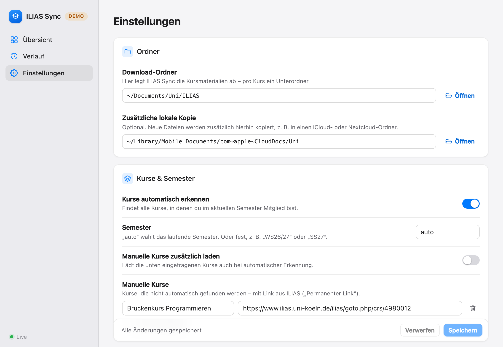
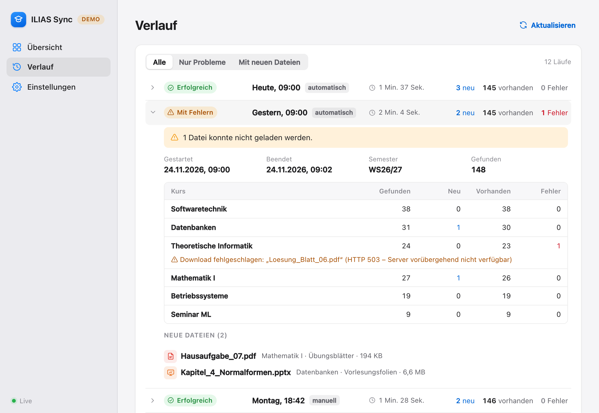

# ILIAS Sync

ILIAS Sync lädt Kursmaterialien aus ILIAS in einen lokalen Ordner. Die
Voreinstellungen sind für die Universität zu Köln ausgelegt. Du kannst
Kurse des aktuellen Semesters automatisch suchen oder gezielt Kurs-URLs
hinterlegen.

## Oberfläche

| Übersicht | Laufender Sync im Dunkelmodus |
| --- | --- |
|  |  |
| **Einstellungen** | **Verlauf** |
|  |  |

## Installation

Voraussetzung ist Python 3.11 oder neuer. Führe die Befehle im Projektordner aus.

Mit pipx für das Desktop-Fenster und die Kommandozeile:

```sh
pipx install --include-deps '.[desktop]'
playwright install chromium
```

Alternativ mit einer virtuellen Umgebung:

```sh
python3 -m venv .venv
source .venv/bin/activate  # Windows PowerShell: .venv\Scripts\Activate.ps1
python -m pip install '.[desktop]'
playwright install chromium
```

Für die Kommandozeile und die Oberfläche im Browser reicht die Installation
von `.`. Unter Linux benötigt das Desktop-Fenster zusätzlich ein passendes
pywebview-Backend.

## Einrichtung

1. Starte die Oberfläche mit `ilias-sync app`. Mit
   `ilias-sync serve --open-browser` öffnest du sie im Browser. Die HTTP-API ist
   lokal unter `http://127.0.0.1:8765/` erreichbar. Der Desktop-Server läuft
   solange das Fenster offen ist. Ein separat gestarteter Server läuft bis
   zum Beenden des Befehls. Der Zeitplan arbeitet ohne Server.
2. Stelle den Download-Ordner ein. Standardmäßig ist das
   `~/Documents/ILIAS Downloads`. Optional kannst du einen zweiten Ordner für
   eine zusätzliche lokale Kopie angeben.
3. Starte in der Oberfläche die Anmeldung oder führe `ilias-sync login` aus.
   Schließe die Anmeldung bei ILIAS im Chromium-Fenster ab, ggf. mit MFA.
4. Starte die Synchronisierung in der Oberfläche oder mit `ilias-sync run`.
   `ilias-sync run --dry-run` zeigt, welche Dateien geladen würden.

Optional kannst du den automatischen Login mit `ilias-sync credentials set`
einrichten. Der Befehl fragt dein Passwort verdeckt ab.
`ilias-sync credentials delete` entfernt die gespeicherten Zugangsdaten.

`ilias-sync config path` zeigt den Pfad zur YAML-Datei an.
`ilias-sync config show` zeigt die aktuelle Konfiguration.
## Umstieg vom alten Skript

`ilias-sync config import <alte config.yaml>` übernimmt die bisherige Konfiguration.
Auf macOS verwendet ILIAS Sync die vorhandenen Schlüsselbund-Zugangsdaten
mit dem importierten Dienstnamen weiter. Der Standarddienst ist
`ilias-koeln-sync`. Melde dich einmal im neuen Browserprofil an.

## Zeitplan

Auf macOS kannst du den Zeitplan in der Oberfläche oder in der Shell
einrichten:

```sh
ilias-sync schedule enable --time 09:00
ilias-sync schedule status
ilias-sync schedule disable
```

Mit `--run-at-login` startet ein Lauf auch beim Laden des LaunchAgents,
etwa bei der Anmeldung. Unter Linux oder Windows kannst du
`ilias-sync run --trigger schedule` mit cron oder dem Aufgabenplaner
ausführen. Der Rechner und das Benutzerkonto müssen für den geplanten Lauf
verfügbar sein.

Auf macOS meldet ILIAS Sync nach geplanten Läufen neue Dateien oder eine
erforderliche Anmeldung. Mit `ilias-sync run --notify` kannst du auch für
einen einzelnen Lauf Mitteilungen anfordern. In einer grafischen macOS-Sitzung
öffnet ein geplanter Lauf bei abgelaufener Sitzung das Login-Fenster. Nach
erfolgreicher Anmeldung versucht er den Sync einmal erneut. Beide Funktionen
lassen sich in den Einstellungen unter „Zeitplan“ abschalten. Mit
`ilias-sync login` kannst du das Login-Fenster selbst öffnen.

## Datenschutz und Nutzung

Konfiguration, Browserprofil, Sitzungsdatei, Protokolle und Verlauf liegen
in den Benutzerverzeichnissen des Betriebssystems. Sitzungsdaten können
Zugriff auf dein ILIAS-Konto ermöglichen. Protokolle und Verlauf können
Kursnamen, URLs und Dateipfade enthalten. Teile diese Daten nicht.
Zugangsdaten für den automatischen Login speichert das Programm im
System-Schlüsselbund. Bei einem Cloud-Zielordner kann dessen Anbieter die
heruntergeladenen Dateien synchronisieren.

ILIAS Sync ist ein unabhängiges Projekt und wird ohne Gewähr bereitgestellt.
Beachte die Nutzungsbedingungen deiner Einrichtung und das Urheberrecht.
Lade nur Materialien herunter, auf die du berechtigt zugreifen darfst.
Die Berechtigung zum Download erlaubt keine Weitergabe.

[MIT-Lizenz](LICENSE)
