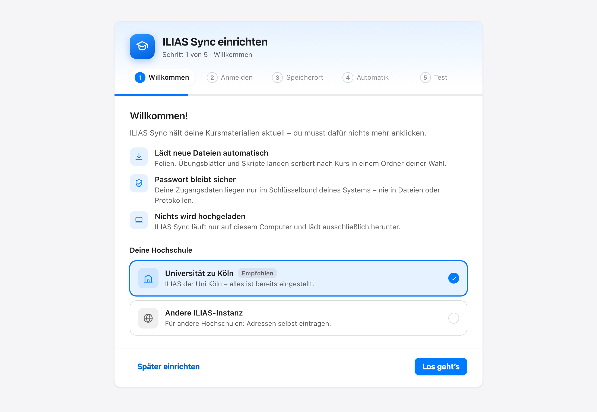
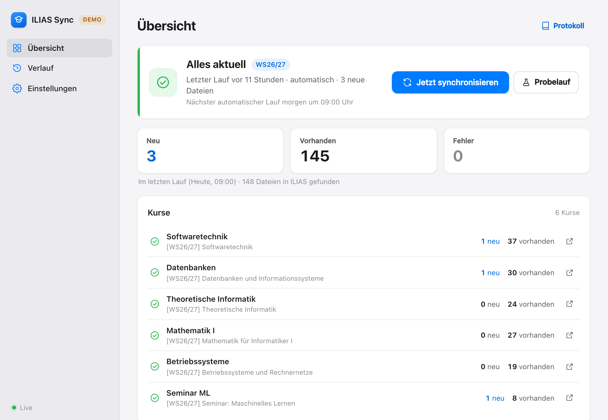
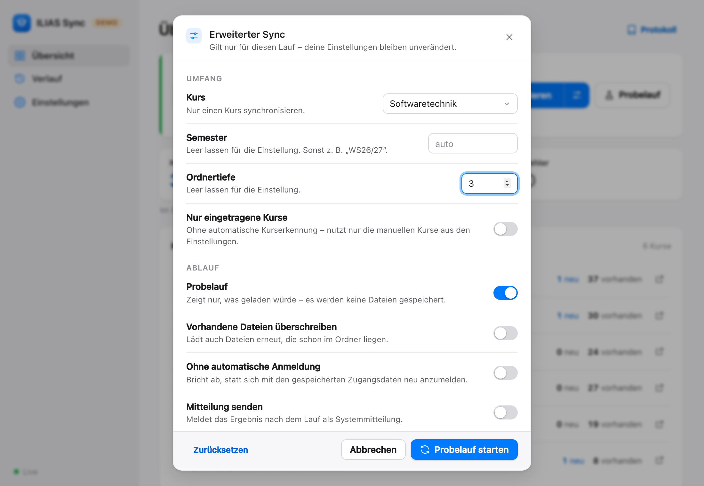
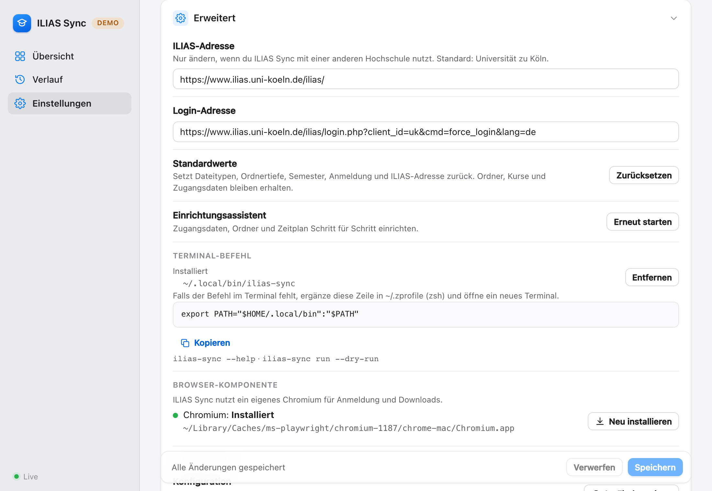
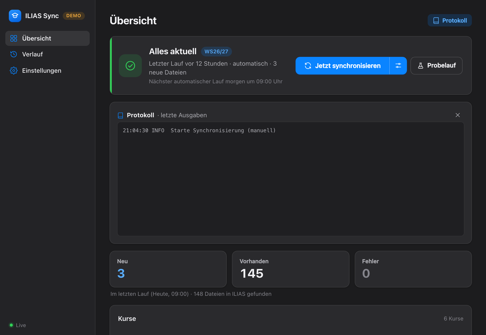

# ILIAS Sync

ILIAS Sync lädt Kursmaterialien aus ILIAS in einen lokalen Ordner. Die
Voreinstellungen sind für die Universität zu Köln ausgelegt. Du kannst
Kurse des aktuellen Semesters automatisch suchen oder gezielt Kurs-URLs
hinterlegen.

## Download

Öffne das [aktuelle GitHub-Release](https://github.com/Git-Tim1/ilias-sync/releases/latest)
und lade unter **Assets** das passende Paket herunter.

| Plattform | Paket | Start |
| --- | --- | --- |
| macOS | `ILIAS-Sync-<Version>-macOS-arm64.dmg` für Apple Silicon oder `…-macOS-x86_64.dmg` für Intel | DMG öffnen, **ILIAS Sync** in **Programme** ziehen und dort öffnen |
| Windows x64 | `ILIAS-Sync-<Version>-Windows-x86_64.zip` | ZIP vollständig entpacken und `ilias-sync.exe` starten |
| Linux x64 | `ILIAS-Sync-<Version>-Linux-x86_64.tar.gz` | Archiv entpacken und `ilias-sync` ausführen. Die Oberfläche öffnet sich im Standardbrowser |
| pip | `ilias_sync-<Version>-py3-none-any.whl` | Mit Python 3.11+ per `pip install ./ilias_sync-<Version>-py3-none-any.whl` installieren und `ilias-sync app` starten |

Beim ersten Start führt die Einrichtung durch die Installation der
Browser-Komponente. Der Chromium-Download benötigt je nach Plattform und Chromium-Version
etwa 150 bis 200 MB. Du kannst ihn auch in den Einstellungen starten.

- **macOS:** Die App ist ad hoc signiert. Wenn Gatekeeper beim ersten Versuch
  blockiert, nutze auf älteren macOS-Versionen **Rechtsklick → Öffnen**.
  Auf neueren Versionen findest du **Trotzdem öffnen** unter
  **Systemeinstellungen → Datenschutz & Sicherheit**.
  [Apple-Support](https://support.apple.com/de-de/102445)
- **Windows:** Wenn SmartScreen den offiziellen Download blockiert, wähle
  **Weitere Informationen → Trotzdem ausführen**, sofern angeboten.
  Für das App-Fenster ist die Microsoft Edge WebView2 Runtime vorgesehen.
  [Microsoft WebView2](https://developer.microsoft.com/microsoft-edge/webview2/)
- **Linux:** Das Paket wird auf Ubuntu 22.04 gebaut. Chromium benötigt die
  Systembibliotheken einer von Playwright unterstützten Distribution.
  [Playwright-Systemabhängigkeiten](https://playwright.dev/python/docs/browsers#install-system-dependencies)

## Funktionen

- Kursmaterialien des aktuellen Semesters automatisch finden oder einzelne Kurse abrufen.
- Dateitypen und Ordnertiefe einstellen, einen zweiten Zielordner nutzen und Änderungen vorab im Probelauf prüfen.
- Fortschritt, neu geladene Dateien und Protokolle in der Oberfläche einsehen.
- Auf macOS geplante Läufe und Mitteilungen einrichten.

| Ersteinrichtung | Übersicht |
| --- | --- |
|  |  |
| **Erweiterter Sync** | **Erweiterte Einstellungen** |
|  |  |



## Ersteinrichtung

**Ersteinrichtung:** Beim ersten Start führt ein Assistent in fünf Schritten durch die Einrichtung. Alles ist vorbelegt (Uni Köln, Ordner `~/Documents/Uni`, täglicher Sync um 09:00); im Normalfall gibst du nur deine Uni-Kennung ein. Das Passwort landet ausschließlich im System-Schlüsselbund.

## Alles auch ohne Terminal

**Alles auch ohne Terminal:** Jede Option von `ilias-sync run` steckt im Dialog „Erweiterter Sync“ (Knopf neben „Jetzt synchronisieren“), z. B. einzelner Kurs, anderes Semester, Ordnertiefe oder sichtbarer Browser. Der Dialog zeigt den passenden Terminal-Befehl an. Unter Einstellungen → Erweitert findest du die Speicherorte, die Konfiguration als YAML, den Import einer alten `config.yaml` und die Installation der Browser-Komponente.

## Kommandozeile (CLI)

### Aus der App

Öffne **Einstellungen → Erweitert → Terminal-Befehl** und wähle **Installieren**.
Auf macOS und Linux ist das Standardziel `~/.local/bin/ilias-sync`. Die Karte
zeigt bei Bedarf die Zeile für `~/.zprofile`. Alternativ kannst du im Terminal
die App-Binary mit `shell-command install` aufrufen, etwa auf macOS:

```sh
"/Applications/ILIAS Sync.app/Contents/MacOS/ilias-sync" shell-command install
```

Unter Windows rufst du `.\ilias-sync.exe --help` im entpackten Ordner auf.

### Mit pipx

Mit Python 3.11 oder neuer kannst du das Wheel aus dem Release oder den
Stand des Quellcode-Repos installieren:

```sh
pipx install ./ilias_sync-0.2.1-py3-none-any.whl
# Alternativ direkt aus dem Repo
pipx install git+https://github.com/Git-Tim1/ilias-sync
```

### Aus dem Quellcode

Führe im ausgecheckten Projektordner aus:

```sh
python3 -m venv .venv
source .venv/bin/activate  # Windows PowerShell: .venv\Scripts\Activate.ps1
python -m pip install '.[desktop]'
ilias-sync browser install
```

Für die CLI und die Browser-Oberfläche genügt `python -m pip install .`.
Das Desktop-Fenster benötigt unter Linux zusätzlich ein passendes
pywebview-Backend. Bei der pipx-Installation oben kannst du die
Browser-Oberfläche mit `ilias-sync serve --open-browser` starten.

### Befehlsübersicht

Die Übersicht stammt aus `ilias-sync --help` und der Hilfe der Unterbefehle.
Weitere Optionen zeigt beispielsweise `ilias-sync run --help`.

| Befehl | Unterbefehle |
| --- | --- |
| `ilias-sync run` | — |
| `ilias-sync login` | — |
| `ilias-sync serve` | — |
| `ilias-sync app` | — |
| `ilias-sync config` | `path`, `show`, `import` |
| `ilias-sync credentials` | `set`, `delete` |
| `ilias-sync schedule` | `enable`, `disable`, `status` |
| `ilias-sync browser` | `status`, `install` |
| `ilias-sync shell-command` | `status`, `install`, `uninstall` |

Oberfläche und Zeitplan starten Synchronisierungen über dieselbe CLI. Der
lokale HTTP-Server der Desktop-App läuft nur, solange das Fenster offen ist.
Der Zeitplan funktioniert auch bei geschlossenem Fenster. Mit
`ilias-sync serve` kannst du den Server separat starten.

## Umstieg vom alten Skript

`ilias-sync config import <alte config.yaml>` übernimmt die bisherige Konfiguration.
Auf macOS verwendet ILIAS Sync die vorhandenen Schlüsselbund-Zugangsdaten
mit dem importierten Dienstnamen weiter. Der Standarddienst ist
`ilias-koeln-sync`. Melde dich einmal im neuen Browserprofil an.

## Zeitplan

Auf macOS kannst du den Zeitplan in der Oberfläche oder in der Shell
einrichten:

```sh
ilias-sync schedule enable --time 09:00
ilias-sync schedule status
ilias-sync schedule disable
```

Mit `--run-at-login` startet ein Lauf auch beim Laden des LaunchAgents,
etwa bei der Anmeldung. Unter Linux oder Windows kannst du
`ilias-sync run --trigger schedule` mit cron oder dem Aufgabenplaner
ausführen. Der Rechner und das Benutzerkonto müssen für den geplanten Lauf
verfügbar sein.

Auf macOS meldet ILIAS Sync nach geplanten Läufen neue Dateien oder eine
erforderliche Anmeldung. Mit `ilias-sync run --notify` kannst du auch für
einen einzelnen Lauf Mitteilungen anfordern. In einer grafischen macOS-Sitzung
öffnet ein geplanter Lauf bei abgelaufener Sitzung das Login-Fenster. Nach
erfolgreicher Anmeldung versucht er den Sync einmal erneut. Beide Funktionen
lassen sich in den Einstellungen unter „Zeitplan“ abschalten. Mit
`ilias-sync login` kannst du das Login-Fenster selbst öffnen.

## Datenschutz und Nutzung

Konfiguration, Browserprofil, Sitzungsdatei, Protokolle und Verlauf liegen
in den Benutzerverzeichnissen des Betriebssystems. Sitzungsdaten können
Zugriff auf dein ILIAS-Konto ermöglichen. Protokolle und Verlauf können
Kursnamen, URLs und Dateipfade enthalten. Teile diese Daten nicht.
Zugangsdaten für den automatischen Login speichert das Programm im
System-Schlüsselbund. Bei einem Cloud-Zielordner kann dessen Anbieter die
heruntergeladenen Dateien synchronisieren.

ILIAS Sync ist ein unabhängiges Projekt und wird ohne Gewähr bereitgestellt.
Beachte die Nutzungsbedingungen deiner Einrichtung und das Urheberrecht.
Lade nur Materialien herunter, auf die du berechtigt zugreifen darfst.
Die Berechtigung zum Download erlaubt keine Weitergabe.

[MIT-Lizenz](LICENSE)

## Release-Builds und optionale Signierung

Ein Tag `v<Version>` startet die Release-Builds. Die Version steht in
`src/ilias_sync/__init__.py`. Über **Run workflow** in GitHub Actions kannst du
die Pakete als CI-Artefakte bauen. Lokal erzeugt `packaging/build_macos.sh`
mit `.venv` und den installierten Extras `.[desktop,packaging]` das DMG in
`dist/`.

Für eine spätere macOS-Notarisierung benötigt die CI ein
**Developer ID Application**-Zertifikat mit privatem Schlüssel, etwa als
`MACOS_CERTIFICATE_P12_BASE64` und `MACOS_CERTIFICATE_PASSWORD`. Für
`notarytool` kommen `APPLE_ID`, `APPLE_TEAM_ID` und
`APPLE_APP_SPECIFIC_PASSWORD` oder die entsprechenden App Store Connect
API-Zugangsdaten hinzu. Der Build würde anschließend mit Developer ID
signiert, zur Notarisierung eingereicht und das Ticket am DMG angeheftet.
Für Windows lässt sich eine Authenticode-Signatur mit einem
Code-Signing-Zertifikat oder den Zugangsdaten eines Signierdienstes ergänzen.
